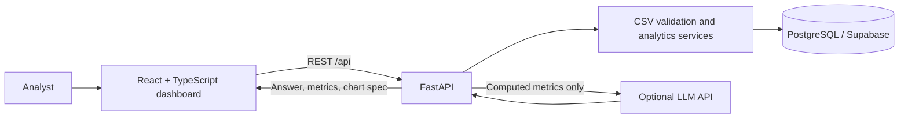

# Northstar Analytics

Northstar is a portfolio-ready sales analytics workspace. Import a CSV, explore normalized sales data through an interactive dashboard, and ask natural-language questions that return computed metrics with a recommended chart.

## Screenshots

Screenshots are not included yet. Capture the Overview, Data Explorer, and Ask Northstar views after starting the app and place them in `docs/screenshots/`.

For a complete file-by-file explanation, data-flow walkthrough, API/schema details, setup commands, test coverage, and interview preparation, see the [Complete Project Guide](docs/PROJECT_GUIDE.md).

## Features

- Drag-and-drop CSV import with required-column, date, numeric, row-count, and file-size validation.
- Dataset-scoped PostgreSQL schema for uploaded files, products, customers, sales, and AI query history.
- Dashboard KPIs, monthly revenue and order trends, regional/category charts, top products, and generated observations.
- Date, region, category, and product filters shared by dashboard metrics and the sales table.
- Natural-language analytics for top products, monthly revenue, regional revenue/growth/decline, underperformers, and dataset overview.
- Chart recommendations returned as structured API data and rendered by the React client.
- Optional OpenAI-compatible answer enrichment. Without a key, deterministic analytics answers remain available.
- Docker Compose deployment with PostgreSQL, FastAPI, and an Nginx-served frontend.
- Optional Databricks sales lakehouse pipeline, with shared Power BI and Tableau reporting views.

## Architecture



The frontend only calls REST endpoints; it never contains database credentials or SQL. FastAPI validates and normalizes uploads, computes analytics against a selected dataset, and returns typed response models. The optional LLM receives a question and precomputed aggregate metrics; it cannot submit or execute SQL. The API owns chart recommendations and chart data, and the frontend renders the returned visualization type.

The optional cloud analytics path is documented in the [Databricks lakehouse and BI guide](docs/LAKEHOUSE_AND_BI.md). It reads a sales CSV into Databricks Bronze/Silver/Gold Delta tables and provides shared reporting views for Power BI and Tableau directly from Databricks.

## Technology

- Frontend: React 19, TypeScript, Vite, Recharts, Lucide
- Backend: Python 3.12, FastAPI, Pydantic, SQLAlchemy
- Database: PostgreSQL 16; SQLite is supported for quick local API development and tests
- AI: optional OpenAI-compatible Chat Completions API with deterministic local fallback
- Delivery: Docker Compose, Nginx

## Project Layout

```text
backend/
  app/              FastAPI routes, schemas, ORM models, AI and analytics services
  data/             Generated sample sales CSV
  scripts/          Sample-data generator
  tests/            API and calculation tests
frontend/
  src/components/   Dashboard, upload, chart, table, filter, and chat components
  src/              App shell, REST client, types, and styles
docker-compose.yml
.env.example
```

## Run Locally

Requirements: Python 3.12+ and Node.js 20+ with npm. In PowerShell from the project root:

```powershell
py -m venv .venv
.\.venv\Scripts\Activate.ps1
python -m pip install -r backend\requirements.txt
$env:DATABASE_URL = "sqlite:///./analytics.db"
Push-Location backend
python -m uvicorn app.main:app --reload
```

In a second terminal:

```powershell
Push-Location frontend
npm install
npm run dev
```

Open `http://localhost:5173`. Vite proxies `/api` to `http://localhost:8000`. The first screen offers a sample-data loader; alternatively, upload your own CSV. FastAPI's interactive API reference is at `http://localhost:8000/docs`.

## Run With Docker

Copy `.env.example` to `.env`, set a local `POSTGRES_PASSWORD`, and keep the `DATABASE_URL` host as `db` for Compose networking. Then run:

```powershell
docker compose up --build
```

Open `http://localhost:8080`; the frontend's Nginx server proxies API requests to FastAPI. PostgreSQL data persists in the `postgres_data` Docker volume. The Compose file intentionally refuses to start until `.env` values are supplied. Do not reuse the example password outside local development.

For Supabase, set `DATABASE_URL` to the project's PostgreSQL connection string using the `postgresql+psycopg://` SQLAlchemy driver form. Preserve Supabase's required SSL mode (for example, `?sslmode=require`) and do not commit that URL. Compose still starts its local database service, but the backend uses the configured `DATABASE_URL`.

## Environment Variables

| Variable | Purpose |
| --- | --- |
| `DATABASE_URL` | SQLAlchemy PostgreSQL/SQLite connection string; Compose uses `db` as its hostname. |
| `POSTGRES_DB` | Local Compose database name. |
| `POSTGRES_USER` | Local Compose database user. |
| `POSTGRES_PASSWORD` | Local Compose database password; set privately in `.env`. |
| `OPENAI_API_KEY` | Optional API key for answer enrichment. Leave blank for deterministic fallback. |
| `OPENAI_BASE_URL` | OpenAI-compatible API root; defaults to `https://api.openai.com/v1`. |
| `OPENAI_MODEL` | Chat Completions model name; defaults to `gpt-4o-mini`. |
| `MAX_UPLOAD_BYTES` | Maximum CSV size; defaults to 10 MiB. |
| `MAX_UPLOAD_ROWS` | Maximum imported data rows; defaults to 100,000. |
| `CORS_ORIGINS` | Comma-separated allowed browser origins. |

To enable LLM answer enrichment, provide an OpenAI API key in `.env` as `OPENAI_API_KEY`. If it is absent or the service is unavailable, the API returns its deterministic answer. LLM responses are limited to explaining metrics already computed by the backend.

## REST API

All endpoints are prefixed with `/api`.

| Method | Path | Behavior |
| --- | --- | --- |
| `GET` | `/health` | API process health. |
| `GET` | `/datasets` | List uploaded datasets. |
| `POST` | `/upload` | Validate and import a multipart CSV file; returns `201`. |
| `POST` | `/demo` | Import the bundled 1,200-row sample dataset. |
| `GET` | `/dashboard` | KPIs, chart series, and generated observations. Supports `dataset_id`, date, region, category, and product filters. |
| `GET` | `/kpis` | Filterable KPI values. |
| `GET` | `/sales` | Filtered, paginated sales records (`limit` up to 500, `offset`). |
| `GET` | `/products` | Product options for a dataset. |
| `GET` | `/categories` | Category options for a dataset. |
| `GET` | `/regions` | Region options for a dataset. |
| `POST` | `/ask` | Controlled natural-language analytics; returns answer, metrics, chart recommendation, and query ID. |

Date filters use ISO dates (`YYYY-MM-DD`); region/category/product values must match dataset values. Without `dataset_id`, the API selects the most recently uploaded dataset.

## Database Design

- `datasets`: source filename, import timestamp, and row count.
- `products`: dataset-scoped product name and category, with a uniqueness constraint.
- `customers`: dataset-scoped external customer ID, with a uniqueness constraint.
- `sales`: fact rows referencing a dataset, product, and customer; stores order date, region, quantity, unit price, and revenue.
- `ai_queries`: question, selected analytics intent, answer, and creation time.

Indexes cover dataset-scoped sales lookups by date and region, plus commonly joined foreign keys and option filters. The SQLAlchemy models in `backend/app/models.py` define the schema. The development app creates tables on startup; a versioned migration workflow is a future improvement.

## AI and Analytics Safety

Questions are mapped to a fixed set of supported intents. A normal analytics service executes the corresponding predefined ORM-backed calculations. No model-generated SQL is accepted or executed. For optional LLM enrichment, the API sends the question and computed aggregate metrics to the configured Chat Completions endpoint; raw customer-level rows and database credentials are not sent. Visualization types are restricted to `line`, `bar`, `pie`, `table`, or `histogram` in the response schema. If no API key is configured or the request fails, deterministic answers and recommendations are returned.

Dashboard observations are deterministic comparisons derived from the currently filtered dataset. Month-over-month growth compares the latest two observed months in the selected data, which may not be adjacent calendar months when there are missing months.

## Security Considerations

- Keep `.env` out of version control; `.gitignore` excludes it.
- Use a unique local database password and a restricted production database role.
- Configure `CORS_ORIGINS` to the deployed frontend origin.
- Uploads are size- and row-bounded, UTF-8 CSV only, and rejected before persistence if any row is invalid.
- LLM access is optional, time-bounded, and limited to precomputed aggregate context.
- Authentication, authorization, tenant isolation, rate limiting, and production migrations are not implemented; this is a local/portfolio application, not a production multi-tenant service.

## Tests

Backend API, ingestion, filtering, KPI, and AI intent tests:

```powershell
Push-Location backend
..\.venv\Scripts\python.exe -m pytest tests -q
```

Frontend component tests and production build:

```powershell
Push-Location frontend
npm install
npm test
npm run build
```

Generate a fresh deterministic sample CSV:

```powershell
..\.venv\Scripts\python.exe backend\scripts\generate_sample_data.py
```

## Future Improvements

- Add authentication, dataset ownership, and row-level tenant isolation.
- Add Alembic migrations and database-level aggregate queries for larger datasets.
- Expand natural-language intent coverage and add date-range comparison controls.
- Add downloadable reports, saved dashboards, and query history in the UI.
- Add browser end-to-end tests and deployment automation.