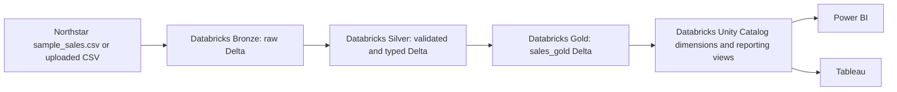

# Databricks Lakehouse and BI

This extension takes Northstar's sales CSV through a Databricks medallion pipeline and exposes shared reporting views directly from Databricks for Power BI and Tableau. It complements the existing local FastAPI/React application; it does not require the app's database to be replaced.

Databricks Free Edition capabilities and quotas can vary. Use only compute and SQL warehouse options shown as available in your workspace, and check the usage limits before connecting external BI tools. Do not upgrade or enable paid resources unless you intend to incur charges.

## Architecture



The pipeline is a full refresh: each run replaces the Bronze, Silver, and Gold Delta tables and recreates the reporting views. It expects one row per `order_id`. Invalid rows and duplicate order IDs stop the run instead of silently changing totals. If the source omits `revenue`, the pipeline derives it from quantity times unit price.

## Run the Pipeline

1. In Catalog Explorer, use the `workspace` catalog or choose a catalog you can write to. Create the `northstar_sales` schema and a volume named `sales` in it. The notebook also attempts to create these objects if permitted.
2. Upload `backend/data/sample_sales.csv` to `/Volumes/workspace/northstar_sales/sales/sample_sales.csv` using the volume browser. If your catalog or schema differs, update the notebook widgets and upload path to match.
3. Import [`databricks/sales_lakehouse.py`](../databricks/sales_lakehouse.py) as a Databricks source notebook. Run its first cell to create the three text widgets at the top of the notebook. Set `source_path` to the uploaded CSV's full volume path, `catalog` to its catalog, and `schema` to the schema you created. Then run the remaining cells on compute available to your account. Check that `<catalog>.<schema>.sales_gold` and its reporting views appear in Catalog Explorer.

The notebook does not require external connectors or credentials. For incremental production loads, replace the documented full-refresh behavior with a watermark or `MERGE` design after defining how updates and deletes are identified.

## Shared BI Model

Connect either BI tool to the Databricks SQL warehouse and select catalog `workspace`, schema `northstar_sales`. The common model is:

| View | Grain and use |
| --- | --- |
| `fact_sales` | One order row; revenue, quantity, customer, product, region, and date key. |
| `dim_date` | One observed order date; year, quarter, month, and month name. |
| `dim_product` | One product/category combination, keyed by a deterministic product ID. |
| `dim_customer` | One customer ID. |
| `dim_region` | One region. |
| `monthly_sales` | Month, region, and category aggregates for trend reporting. |
| `product_performance` | Product/category totals and average order value. |
| `regional_performance` | Region/category totals and customer counts. |

In a BI semantic model, relate `dim_date[date_id]` to `fact_sales[date_id]`, `dim_product[product_id]` to `fact_sales[product_id]`, `dim_customer[customer_id]` to `fact_sales[customer_id]`, and `dim_region[region]` to `fact_sales[region]`. Use one-to-many, single-direction relationships. Set date fields to date types and revenue/unit price to fixed decimal/currency.

Recommended report pages:

- **Executive Overview:** revenue, orders, average order value, units, monthly revenue trend, and revenue by region.
- **Product Performance:** revenue and units by product/category, with date and region filters.
- **Regional Operations:** monthly revenue and orders by region, with category and date filters.

### Power BI

Use **Get Data > Azure Databricks**. Enter the Server Hostname and HTTP Path from your Databricks SQL warehouse, then authenticate using the method configured for your workspace. Select the `workspace.northstar_sales` views. Import mode is simplest for a small portfolio dataset; DirectQuery sends report queries to the SQL warehouse. Apply the relationships above and create these measures:

```DAX
Revenue = SUM(fact_sales[revenue])
Orders = DISTINCTCOUNT(fact_sales[order_id])
Units Sold = SUM(fact_sales[quantity])
Average Order Value = DIVIDE([Revenue], [Orders])
```

Use `dim_date[order_date]` for the trend axis and mark it as the model's date table. Configure an approved gateway/connection and credentials before publishing a scheduled-refresh report.

### Tableau

Use Tableau's Databricks connector and enter the same Server Hostname and HTTP Path. Select the `workspace.northstar_sales` views. Relate `fact_sales` to the four dimensions on the keys above; keep the relationship cardinalities one-to-many. Build the same KPI and report pages, with `order_date` as a continuous month for trend charts. Example calculated fields:

```text
Revenue: SUM([revenue])
Orders: COUNTD([order_id])
Units Sold: SUM([quantity])
Average Order Value: SUM([revenue]) / COUNTD([order_id])
```

Publish using a governed Databricks connection and approved refresh schedule. Avoid embedding personal access tokens in a workbook.

## Validation and Limits

- Compare source and Databricks Silver/Gold row counts after each run. Check `SUM(revenue)` and `COUNT(DISTINCT order_id)` in `sales_gold` before validating dashboard totals.
- Run the existing Northstar API tests independently. Executing the notebook requires an accessible Databricks workspace and compute.
- The dimensions are views over the current fact table. They are suitable for a portfolio model; production dimensions needing historical attributes should become managed tables with explicit slowly changing dimension rules.