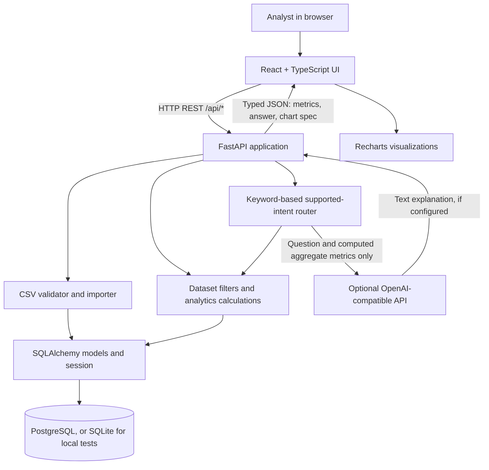

# Northstar Analytics: Complete Project Guide

This guide explains the project as implemented: what it does, what each part is responsible for, how data moves through the system, how to run and test it, and what remains outside its scope. It is intended as both a developer guide and an interview-preparation reference.

## 1. Project at a Glance

Northstar is a sales analytics web application. An analyst can load a bundled sample dataset or upload their own CSV, inspect aggregate sales metrics and individual rows, filter dashboard results, and ask a bounded set of natural-language questions.

The system has three runtime services:

1. **Frontend:** React and TypeScript, built by Vite and served in the production Compose setup by Nginx.
2. **Backend:** Python and FastAPI. It owns CSV validation, REST endpoints, analytics, AI intent routing, and response validation.
3. **Database:** PostgreSQL. SQLAlchemy models describe datasets, products, customers, sales, and saved questions.

The bundled development dataset has 1,200 rows, 12 products, five regions, and records spanning 18 observed months. An optional OpenAI-compatible API can enrich answers. The app works without that credential using deterministic responses.

## 2. What a User Can Do

- Load the bundled sample data or upload a `.csv` file.
- See upload validation feedback rather than silent partial imports.
- View total revenue, order count, average order value, unique customers, and month-over-month revenue growth.
- Explore monthly revenue and order volume, revenue by region and category, top products, and calculated observations.
- Filter dashboard summaries and sales rows by date range, region, category, and product.
- Page through individual sales records.
- Ask supported questions such as “Top 5 products by revenue”, “Show monthly revenue”, “Which region grew fastest?”, and “Which region had the biggest revenue decline?”
- View the API contract in FastAPI Swagger UI at `/docs`.

## 3. System Architecture



### Request lifecycle

1. The browser calls a function in `frontend/src/api.ts`.
2. In local Vite development, Vite proxies `/api` to `http://localhost:8000`. In Docker, Nginx proxies `/api` to the `backend` Compose service.
3. FastAPI validates query/body inputs and uses a request-scoped SQLAlchemy session.
4. A service applies dataset and filter constraints, retrieves records, and computes or persists the result.
5. Pydantic response models validate and describe the JSON response.
6. The frontend updates React state and renders UI components or charts.

## 4. Repository Layout and File Responsibilities

### Root files

- `README.md`: Short project landing page, setup, API overview, security notes, and links to the full guide.
- `docs/PROJECT_GUIDE.md`: This detailed architecture and implementation reference.
- `docs/screenshots/README.md`: Names the suggested screenshots to add after capture. Screenshots are not currently committed.
- `.env.example`: Environment-variable template. It contains placeholders only; copy it to a local `.env` and set private values there.
- `.gitignore`: Excludes `.env`, virtual environments, Python caches, SQLite databases, Node dependencies, and frontend build output.
- `docker-compose.yml`: Defines PostgreSQL, the FastAPI service, the Nginx-served frontend, their ports, and the persistent database volume.

### Backend

- `backend/requirements.txt`: Tested Python dependency versions used by the backend container and local environment.
- `backend/Dockerfile`: Builds the Python API image, installs requirements, and copies API source plus sample CSV data.
- `backend/app/config.py`: Reads database URL, upload limits, and optional LLM configuration from environment variables.
- `backend/app/database.py`: Creates the SQLAlchemy engine/session factory and exposes the request-scoped database dependency. It adds SQLite's thread option when using SQLite.
- `backend/app/models.py`: Declares the relational ORM schema and indexes.
- `backend/app/schemas.py`: Defines Pydantic request/response contracts, including KPI, dataset, sales page, and AI answer objects.
- `backend/app/main.py`: Creates the FastAPI application, CORS policy, startup table creation, database error handler, CSV/demo import endpoints, dashboard and options endpoints, sales pagination, and the `/ask` workflow.
- `backend/app/services/csv_import.py`: Parses and validates CSV bytes before a database write is attempted.
- `backend/app/services/analytics.py`: Selects a dataset, builds a filtered SQLAlchemy query, and calculates summaries from returned records.
- `backend/app/ai/service.py`: Maps supported question wording to fixed intents, builds deterministic answers and chart specifications, and optionally calls an OpenAI-compatible Chat Completions endpoint.
- `backend/data/sample_sales.csv`: The generated 1,200-row sample sales dataset used by the demo loader.
- `backend/scripts/generate_sample_data.py`: Deterministically regenerates the sample CSV with a fixed random seed.
- `backend/tests/test_api.py`: FastAPI integration tests using an isolated in-memory SQLite database.

### Frontend

- `frontend/package.json`: React, Recharts, Lucide, TypeScript, Vite, Vitest, and component-test scripts.
- `frontend/package-lock.json`: Locked npm dependency graph used by `npm ci` in Docker builds.
- `frontend/tsconfig.json`: Strict TypeScript compiler configuration.
- `frontend/vite.config.ts`: React plugin, local API proxy, and Vitest environment configuration.
- `frontend/index.html`: HTML document, metadata, font links, and root mounting point.
- `frontend/Dockerfile`: Multi-stage Node build followed by a small Nginx image serving static assets.
- `frontend/.dockerignore`: Keeps `node_modules`, `dist`, coverage, Vite cache, and local environment files out of the Docker build context.
- `frontend/nginx.conf`: Serves the single-page app and proxies `/api/` to FastAPI.
- `frontend/src/main.tsx`: Mounts the React application and global CSS.
- `frontend/src/App.tsx`: Owns view selection, dataset selection, API health state, filters, dashboard loading, option loading, table pagination, and empty/loading/error states.
- `frontend/src/api.ts`: Typed REST client, query-string construction, upload request, and readable API error conversion.
- `frontend/src/types.ts`: Shared TypeScript models for datasets, KPIs, charts, filters, sales rows, and AI responses.
- `frontend/src/styles.css`: Responsive visual system, layout, typography, colors, and reduced-motion support.
- `frontend/src/vite-env.d.ts`: Vite client type declarations.
- `frontend/src/testSetup.ts`: Testing Library matchers loaded for Vitest.
- `frontend/src/components/Sidebar.tsx`: Main view navigation.
- `frontend/src/components/KpiCard.tsx`: Reusable metric tile and growth indicator.
- `frontend/src/components/ChartCard.tsx`: Recharts line, bar, and pie charts; also renders simple table-like chart results.
- `frontend/src/components/FilterPanel.tsx`: Date, region, category, and product controls plus clear-filters action.
- `frontend/src/components/UploadArea.tsx`: File chooser, drag/drop, client-side extension check, upload state, and error/success messaging.
- `frontend/src/components/DataTable.tsx`: Sales table with previous/next pagination.
- `frontend/src/components/AIChat.tsx`: Question field, prompts, loading/errors, deterministic/LLM answer, and recommended chart display.
- `frontend/src/components/AIInsightCard.tsx`: Displays deterministic observations returned by the dashboard API.
- `frontend/src/components/Sidebar.test.tsx`: Navigation component test.
- `frontend/src/components/UploadArea.test.tsx`: Invalid file-extension feedback test.

## 5. CSV Contract and Validation Rules

Column headers are trimmed and normalized to lowercase. Required headers are:

```text
order_id, order_date, customer_id, product, category, region, quantity, unit_price
```

`revenue` is optional. If omitted or blank on a row, revenue is calculated as `quantity * unit_price`. Additional columns are ignored.

Validation implemented in `backend/app/services/csv_import.py`:

- Upload route must receive a filename ending in `.csv` (case-insensitive).
- File bytes must be non-empty and within `MAX_UPLOAD_BYTES` (default 10 MiB).
- Content must decode as UTF-8; a UTF-8 BOM is accepted.
- CSV must have a header row and unique normalized column names.
- All required columns must exist.
- Required row values cannot be blank.
- `order_date` must be a valid ISO date, for example `2025-03-14`.
- `quantity` must be finite, a positive whole number.
- `unit_price` and `revenue` must be finite and non-negative.
- Row count cannot exceed `MAX_UPLOAD_ROWS` (default 100,000).
- Invalid row details are collected (up to 20) and the import is rejected before data is persisted.
- Header-only files are rejected as empty datasets.

The CSV reader treats the file as records; this is not a spreadsheet formula evaluator. The importer does not currently perform broad schema inference, row repair, or partial-row acceptance.

## 6. Database Design

SQLAlchemy models create the tables when the FastAPI app starts. The database structure is dataset-scoped so records from separate imports are not aggregated together.

### `datasets`

- `id`: integer primary key.
- `name`: source filename or `sample_sales.csv`.
- `row_count`: count of imported sale lines.
- `uploaded_at`: database-generated timestamp.

### `products`

- `id`: integer primary key.
- `dataset_id`: dataset foreign key and index.
- `name`: product name.
- `category`: category name and index.
- Unique constraint: `(dataset_id, name, category)`.

### `customers`

- `id`: integer primary key.
- `dataset_id`: dataset foreign key and index.
- `external_id`: customer ID from the CSV.
- Unique constraint: `(dataset_id, external_id)`.

### `sales`

- `id`: integer primary key.
- `dataset_id`: dataset foreign key and index.
- `order_id`: source order ID and index. Multiple sale lines can reference the same order.
- `order_date`: SQL date.
- `customer_id`, `product_id`: foreign keys and indexes.
- `region`: region value and index.
- `quantity`, `unit_price`, `revenue`: normalized fact values.
- Compound indexes: `(dataset_id, order_date)` and `(dataset_id, region)`.

### `ai_queries`

- `id`: integer primary key.
- `dataset_id`: dataset foreign key and index.
- `question`: submitted natural-language question.
- `intent`: the selected supported analytics intent.
- `answer`: answer returned to the user.
- `created_at`: database-generated timestamp.

SQLite is used in backend tests and can be selected for local development. Compose uses PostgreSQL 16 and persists its files in the named `postgres_data` volume. Supabase can be used by setting `DATABASE_URL` to a compatible PostgreSQL connection string. Alembic migrations are not yet implemented; the current development setup uses `Base.metadata.create_all` at startup.

## 7. Analytics and KPI Definitions

All dashboard metrics are based on the selected dataset and the active date/region/category/product filters.

- **Total revenue:** Sum of `sales.revenue` across filtered sales lines.
- **Total orders:** Count of distinct `order_id` values, not number of CSV rows.
- **Average order value:** Filtered revenue divided by distinct filtered order count; returns zero when there are no orders.
- **Total customers:** Count of distinct external customer IDs in the filtered rows.
- **Monthly revenue:** Sum of revenue grouped by the `YYYY-MM` portion of `order_date`.
- **Revenue by region/category:** Revenue grouped by region or joined product category.
- **Top products:** Product revenue totals sorted descending; dashboard shows the first five.
- **Order trend:** Distinct order IDs grouped by month.
- **Revenue growth:** Percentage change between the latest and previous *observed* month totals: `(latest - previous) / previous * 100`. If there are fewer than two observed months, or the prior month is zero, growth is `null`.
- **Regional/category change:** For each region/category with nonzero revenue in the prior observed month, compare latest versus prior observed month as a percentage. A region/category with no prior-month sales is excluded from this comparison.
- **Lowest-revenue products:** The five products with the smallest total revenue in the selected filtered view. This is not a statistical underperformance or declining-trend model.
- **Dashboard observations:** Deterministic text summaries for latest observed month, highest-revenue region, and overall month-over-month revenue change.

Observed months can be non-adjacent calendar months if the source data has gaps. The app does not currently fill missing months with zeros, adjust for seasonality, or calculate statistical significance.

## 8. Natural-Language Analytics and LLM Boundary

The question feature is a controlled analytics router, not a general-purpose text-to-SQL system.

### Current intent mapping

- Top/best products and “top 5” wording → `top_products`, a descending product-revenue ranking and bar chart.
- Regional revenue question → `regional_revenue`, region totals and a bar chart.
- Fastest-growing region → `regional_growth`, latest-vs-prior observed-month regional changes and a bar chart.
- Biggest regional decline → `regional_decline`, the lowest regional percent change and a bar chart.
- Monthly, month-over-month, trend, or over-time wording → `monthly_revenue`, monthly revenue and a line chart.
- Revenue decline/decrease wording without a region → `revenue_decline`, overall revenue change and category changes.
- Underperforming product wording → `underperformers`, products with the lowest revenue in the current view. It does not currently infer a declining product trend.
- Other questions → `overview`, a general summary of orders, revenue, customers, average order value, and growth.

Classification is based on keyword matching in `backend/app/ai/service.py`; it does not use embeddings or an LLM to choose the calculation. Unsupported or ambiguous wording can fall through to a broad/default intent.

### Optional LLM answer enrichment

When `OPENAI_API_KEY` is set, the backend sends the question, its computed answer, and aggregate metrics to the configured OpenAI-compatible Chat Completions endpoint. It does not send raw customer-level sale rows or database credentials. A 12-second request timeout is used. If the LLM request errors or returns unusable content, the deterministic answer is retained. Without a key, no external request is made.

The LLM does not choose or execute SQL and does not determine chart data. The intent/calculation layer supplies a structured visualization type, title, and chart points. Pydantic restricts the visualization type to `line`, `bar`, `pie`, `table`, or `histogram`.

## 9. REST API Reference

All routes use the `/api` prefix. See `http://localhost:8000/docs` when the stack is running for the generated interactive schema.

### `GET /api/health`

Returns `{"status":"ok"}`. This checks the API process, not a complete database query.

### `GET /api/datasets`

Returns datasets ordered by most recently uploaded. Dataset response fields are `id`, `name`, `row_count`, and `uploaded_at`.

### `POST /api/upload`

Accepts multipart form data with a `file` field. Returns HTTP `201`, a dataset object, and a warnings list (currently empty for successful imports). Invalid extension returns `415`; validation problems return `422`; size/row-limit problems return `413`.

### `POST /api/demo`

Imports `backend/data/sample_sales.csv` as a new dataset and returns HTTP `201`. Repeated calls create additional dataset records; the endpoint does not deduplicate demo imports.

### `GET /api/dashboard`

Returns the dataset object, nested `kpis`, chart series, and observations. Optional query parameters: `dataset_id`, `start_date`, `end_date`, `region`, `category`, `product`. Dates use `YYYY-MM-DD`; start cannot follow end. If `dataset_id` is omitted, the newest dataset is selected. If no dataset exists, returns `404`.

### `GET /api/kpis`

Returns the same five KPI fields as `/api/dashboard`, and accepts the same dataset and filter parameters.

### `GET /api/sales`

Returns `{items, total, limit, offset}`. Accepts the dashboard filters plus `limit` (default 100, range 1–500) and `offset` (default zero, non-negative). The frontend requests 50 rows per page.

### `GET /api/products`, `GET /api/categories`, `GET /api/regions`

Return distinct, sorted option arrays for the selected dataset. Each accepts optional `dataset_id`; without it the latest dataset is used.

### `POST /api/ask`

Accepts JSON `{ "question": "..." }` and optional `dataset_id` query parameter. Questions must be 1–1,000 characters after trimming. Returns `{answer, intent, metrics, visualization, query_id}` and saves the question/answer record.

## 10. Frontend Behavior

`App.tsx` is a small client-side view switcher with four views: Overview, Ask Northstar, Data Explorer, and Import Data. It does not use a separate routing library.

- On startup it requests API health and dataset list, then selects the most recent dataset if one exists.
- A dataset/filter change requests new dashboard data.
- A dataset change requests filter-option lists.
- Opening Data Explorer requests the current filtered page of sales rows.
- Changing filters in Data Explorer resets its page offset.
- Upload/demo success selects the new dataset and returns to the dashboard.
- API failures are translated into visible messages by `api.ts` and UI components.
- The design includes a mobile sidebar, responsive chart layout, and reduced-motion support.

The frontend uses relative `/api` calls. During development Vite proxies requests to port 8000. In the production image, Nginx serves the Vite build and proxies `/api/` to the backend Compose service. `VITE_API_URL` can be used as a frontend base URL override when building a client for a different environment.

## 11. Run the Project

### Docker Compose (recommended)

Prerequisites: Docker Desktop with its Linux engine running. From the repository root in PowerShell:

```powershell
Copy-Item .env.example .env
```

Edit `.env` and replace `POSTGRES_PASSWORD` with a private local password. Make `DATABASE_URL` use the same password and keep `db` as the host, for example:

```text
POSTGRES_PASSWORD=your-private-local-password
DATABASE_URL=postgresql+psycopg://northstar:your-private-local-password@db:5432/northstar
```

Then run:

```powershell
docker compose up --build
```

Open the app at `http://localhost:8080`; API docs are at `http://localhost:8000/docs`. Stop the attached Compose process with `Ctrl+C`. To stop detached services use `docker compose down`; that keeps the named volume. Do not use `docker compose down -v` unless you intend to remove the local database volume and all its stored data.

### Local development without Docker

Python 3.12+ and Node.js/npm are required. In PowerShell terminal 1:

```powershell
py -m venv .venv
.\.venv\Scripts\Activate.ps1
python -m pip install -r backend\requirements.txt
$env:DATABASE_URL = "sqlite:///./analytics.db"
Set-Location backend
python -m uvicorn app.main:app --reload
```

In terminal 2 from the project root:

```powershell
npm.cmd --prefix frontend ci
npm.cmd --prefix frontend run dev
```

Open `http://localhost:5173`. The Vite proxy forwards `/api` requests to `http://localhost:8000`.

### Optional LLM configuration

Set `OPENAI_API_KEY` in the ignored local `.env` to enable answer enrichment. `OPENAI_BASE_URL` and `OPENAI_MODEL` can select a compatible provider and model. Do not put credentials in source files, README examples, or commits. The rest of the app remains functional without the LLM key.

## 12. Tests and Verification

### Backend

From the project root:

```powershell
Set-Location backend
..\.venv\Scripts\python.exe -m pytest tests -q
```

The API tests use FastAPI `TestClient` and a fresh in-memory SQLite database. Coverage includes successful upload and dashboard metrics, filtered sales, missing columns, invalid dates and rejection without partial dataset creation, top-product AI response/chart, regional growth/decline comparisons, missing-dataset handling, and bundled demo loading.

### Frontend

From the project root:

```powershell
npm.cmd --prefix frontend ci
npm.cmd --prefix frontend test
npm.cmd --prefix frontend run build
npm.cmd --prefix frontend audit
```

Current component tests cover navigation selection and clear invalid-file feedback. The production build runs strict TypeScript checking before Vite bundling. There is not yet a browser automation suite or a backend/database failure-injection suite.

### Sample data generator

```powershell
.\.venv\Scripts\python.exe backend\scripts\generate_sample_data.py
```

The generator uses a fixed seed so generated values are repeatable. Running it rewrites the tracked sample CSV; review the change if you intentionally regenerate it.

## 13. Security, Reliability, and Boundaries

- `.env` is ignored by Git; `.env.example` contains placeholders, not usable secrets.
- The database password is supplied as an environment variable and is not embedded in the frontend bundle.
- CSV upload is bounded by byte and row limits and validates all rows before the import transaction is committed.
- SQL is assembled by SQLAlchemy from fixed application code; user text is not concatenated into SQL.
- The LLM request is optional and only receives question text and aggregate metrics. The application falls back to deterministic answers on absent configuration or request failure.
- CORS origins are configurable with `CORS_ORIGINS`.
- The app does not currently provide authentication, user accounts, authorization, per-tenant ownership enforcement, rate limiting, audit controls, or production-grade migration/backup procedures.
- An API health response confirms the API route responded; database availability is separately observed through requests that use the database.
- ORM table creation on startup is suitable for this demo, not a substitute for a reviewed production migration plan.

## 14. Known Limitations and Next Steps

- Intent classification is keyword-based, not a general semantic language model; unexpected wording may fall back to overview.
- “Underperformers” means lowest total revenue in the selected view, not products with a statistically meaningful declining trend.
- Month comparisons use observed months and do not fill missing calendar months or adjust for seasonal effects.
- The metrics service loads filtered sale rows into application memory and aggregates them in Python; this is appropriate for the bounded demo CSV but should move toward SQL aggregation for larger datasets.
- Currency is displayed as USD in the UI; per-dataset currency metadata is not implemented.
- No authentication, saved dashboard configuration, downloadable reports, migrations, CI workflow, or browser E2E tests are included yet.
- The main JavaScript output is around 681 KB minified in the observed production build; consider route/component splitting if bundle startup becomes a concern.
- README screenshot locations are placeholders; capture actual screenshots from the running app before publishing a portfolio repository.

## 15. Interview Explanation

### 30-second version

“I built a full-stack sales analytics platform. It ingests and validates CSV data, stores it in a normalized PostgreSQL schema, and exposes filterable KPIs, charts, and paginated records through FastAPI. Its natural-language feature maps supported questions to predefined calculations and returns both an answer and a chart recommendation. React renders the dashboard, while Docker Compose runs the frontend, API, and database.”

### Questions worth preparing for

1. **Why use a relational schema?** Dataset, product, customer, and sale entities have clear relationships; normalization avoids repeating dimensions for every sale and lets queries filter or join consistently.
2. **How are order totals counted?** Sales are line items, so an order may contain multiple rows. `total_orders` counts distinct `order_id`, while revenue sums line revenue.
3. **How do you prevent text-to-SQL risk?** A fixed intent set selects known application calculations. The LLM is only an optional explanation layer for precomputed aggregate results.
4. **How is a bad CSV handled?** The parser validates headers and row values before persistence; invalid rows return useful errors and the upload is not partially imported.
5. **What does the growth KPI mean?** It is the percentage difference between the latest two observed month totals, with `null` when a meaningful denominator/comparison is unavailable.
6. **What would you improve for production?** Authentication and tenant isolation, Alembic migrations, SQL-side aggregation, rate limiting, observability, backups, and end-to-end CI tests.

## 16. Quick Demo Script

1. Open `http://localhost:8080` and choose **Explore sample data** if a dataset is not selected.
2. Point out the dataset selector, date/region/category/product filters, KPIs, trend charts, and deterministic observation panel.
3. Open **Data explorer** and show filtered rows and pagination.
4. Open **Ask Northstar**, ask “Which region grew fastest?”, and explain that the returned answer and bar chart come from a controlled calculation.
5. Open **Import data** and explain the required CSV columns and validation feedback.
6. For architecture, show `/docs`, this guide, the ORM models, and Compose services.